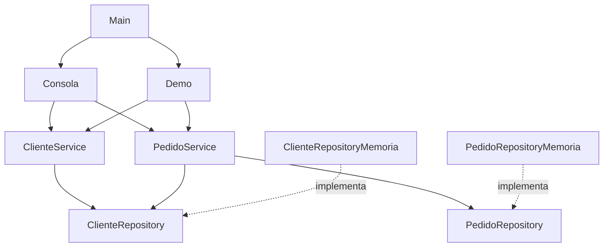

# Gestión de clientes y pedidos — Java 21

Aplicación de consola basada en `Proyecto_Integrador_Sesion_7_Java_21.md`. Implementa el caso de estudio y agrega un menú interactivo, pruebas automatizadas y configuración para Visual Studio Code. Java puro, sin Spring, Maven ni librerías externas.

## Inicio rápido en Visual Studio Code

Requisitos: **JDK 21** y **Extension Pack for Java** (`vscjava.vscode-java-pack`). La recomendación de extensión está incluida en `.vscode/extensions.json`.

Las tareas ejecutan PowerShell y están preparadas para Windows. El código Java también se puede compilar directamente en Linux/macOS.

### Terminal PowerShell

Ejecute desde la raíz del proyecto:

```powershell
# Compilar y ejecutar la demostración
powershell -NoProfile -ExecutionPolicy Bypass -File .\scripts\java.ps1 demo

# Compilar y abrir el menú con datos inicialmente vacíos
powershell -NoProfile -ExecutionPolicy Bypass -File .\scripts\java.ps1 interactivo

# Compilar y ejecutar todas las pruebas
powershell -NoProfile -ExecutionPolicy Bypass -File .\scripts\java.ps1 test

# Solo compilar
powershell -NoProfile -ExecutionPolicy Bypass -File .\scripts\java.ps1 build
```

`-ExecutionPolicy Bypass` se aplica únicamente al proceso de PowerShell de ese comando; no modifica la política persistente del equipo. El script funciona también desde otra carpeta mediante su ruta absoluta y admite rutas con espacios.

La compilación utiliza `--release 21 -encoding UTF-8 -Xlint:all -Werror`: cualquier advertencia del compilador hace fallar la construcción. Las pruebas fallidas producen un código de salida distinto de cero.

### Salida del caso de estudio

```text
Cliente: Carlos
Pedidos registrados: 3
Total pagado: S/ 170.00
```

Se registran Carlos activo, Ana inactiva y tres pedidos de Carlos: S/ 120.50 pagado, S/ 80.00 pendiente y S/ 49.50 pagado. El monto pendiente no participa en el total.

### Compilación manual en PowerShell

```powershell
$fuentesJava = Get-ChildItem .\src\main\java -Recurse -Filter *.java |
    ForEach-Object { $_.FullName }
javac --release 21 -encoding UTF-8 -d out/main $fuentesJava
java -cp out/main com.empresa.gestion.app.Main
java -cp out/main com.empresa.gestion.app.Main --interactivo
```

### Linux/macOS

```bash
mkdir -p out/main out/test
find src/main/java -name '*.java' > out/main-sources.txt
javac --release 21 -encoding UTF-8 -Xlint:all -Werror -d out/main @out/main-sources.txt
java -cp out/main com.empresa.gestion.app.Main --demo
java -cp out/main com.empresa.gestion.app.Main --interactivo

find src/test/java -name '*.java' > out/test-sources.txt
javac --release 21 -encoding UTF-8 -Xlint:all -Werror -cp out/main -d out/test @out/test-sources.txt
java -cp out/main:out/test com.empresa.gestion.app.Pruebas
```

Los comandos Bash asumen que los nombres relativos de los archivos fuente no contienen espacios, como en la estructura incluida. Su ejecución debe detenerse si falla una compilación.

## Uso del menú

| Opción | Operación |
| --- | --- |
| 1 | Registrar cliente: ID positivo, nombre y activo `s/n` |
| 2 | Consultar un cliente por ID |
| 3 | Registrar pedido: ID, cliente, monto y estado (`1` pendiente, `2` pagado) |
| 4 | Listar pedidos de un cliente por ID ascendente |
| 5 | Consultar el total pagado del cliente |
| 0 | Finalizar la sesión |

Use punto decimal y ningún separador de miles, por ejemplo `120.50`. Ante una entrada inválida o una regla de negocio incumplida, se informa el motivo y se regresa al menú. El fin de entrada también cierra la sesión sin error. Los datos desaparecen al salir; cada ejecución comienza con nuevos repositorios.

`Main` admite `--demo`, `--interactivo` y `--help`. Sin argumentos ejecuta la demostración. Un argumento desconocido devuelve código de salida `2`.

## Arquitectura y decisiones

```text
src/main/java/com/empresa/gestion/
├── app/             Main, Demo y Consola: composición y entrada/salida
├── model/           Cliente, Pedido y EstadoPedido: invariantes del dominio
├── repository/      Interfaces de persistencia
├── infrastructure/  Implementaciones con HashMap
└── service/         Registro, consultas y reglas de negocio
src/test/java/com/empresa/gestion/app/
└── Pruebas.java     Suite ejecutable sin dependencias
.vscode/             Tareas, depuración y recomendaciones
scripts/java.ps1     Compilación, ejecución y pruebas
```



- **Dominio válido desde su creación:** los constructores compactos de los `record` validan IDs, nombres, monto y estado. `String`, `BigDecimal` y el `enum` mantienen los componentes inmutables.
- **Precisión decimal:** se construyen importes desde texto con `BigDecimal`; no se usa `double`. El total suma únicamente `PAGADO` mediante Streams. La presentación agrega dos decimales cuando faltan, sin redondear importes con mayor escala.
- **Dependencias explícitas:** `Main` comparte los repositorios entre servicios y los inyecta por constructor. Las dependencias son `final` y se rechazan referencias nulas al construir los servicios.
- **Persistencia encapsulada:** `HashMap` permanece privado; `Optional` expresa la ausencia del cliente. Las consultas de pedidos devuelven instantáneas no modificables ordenadas por ID.
- **Consola comprobable:** recibe entrada y salida por constructor, lo que permite probar sesiones completas sin modificar `System.in` ni `System.out`.
- **Errores definidos:** argumentos inválidos producen `IllegalArgumentException`; las referencias obligatorias nulas, `NullPointerException`; un cliente inactivo, `IllegalStateException`. Se mantienen las familias de excepciones del documento.

### Comportamientos conservados de la especificación

| Situación | Resultado |
| --- | --- |
| Registrar un pedido para cliente inexistente | Rechazo sin guardar |
| Registrar un pedido para cliente inactivo | Rechazo sin guardar |
| Guardar el mismo ID de cliente o pedido | Reemplaza el registro anterior |
| Reemplazo de pedido rechazado por una regla | Conserva el pedido anterior |
| Consultar pedidos de un ID sin registros | Lista vacía |
| Consultar total de un ID sin pedidos, aunque el cliente no exista | Cero |
| Monto positivo con más de dos decimales | Se conserva sin redondear |

El reemplazo por ID es deliberado: el documento acepta `Map.put()` para esta etapa. No se agrega una restricción de duplicados que cambie ese contrato. De igual manera, las consultas de pedidos no exigen que exista el cliente; la consola sí exige un ID positivo como entrada.

## Verificación

La suite contiene **21 escenarios** y comprueba validaciones de modelos, búsqueda opcional, reemplazos, pedidos rechazados sin escritura, filtrado, orden, inmutabilidad de consultas, precisión decimal, aislamiento de repositorios y el total del ejemplo. También ejecuta sesiones de consola con operaciones completas, errores recuperables y fin de entrada.

Se usa un ejecutor de pruebas pequeño con aserciones explícitas para mantener el requisito de Java puro sin descargas. No necesita `-ea` y no depende de JUnit. Cada escenario crea sus propios repositorios.

Validación realizada en Windows con **Eclipse Temurin JDK 21.0.12.1**: compilación sin advertencias y **21 pruebas correctas, 0 fallidas**. Los comandos de Linux/macOS se proporcionan como alternativa; no se han ejecutado en este entorno.

## Alcance

Esta es la aplicación educativa de la especificación, con persistencia temporal y ejecución en un solo hilo. `HashMap` no ofrece garantías de concurrencia ni transacciones entre repositorios. No hay almacenamiento durable, autenticación, API REST ni reglas de transición de estados. El reemplazo de un cliente no modifica sus pedidos ya registrados.

Para evolucionar a un servicio de producción, primero habría que definir contratos de alta y actualización, moneda y escala, transacciones y persistencia durable. Los contratos de repositorio permiten sustituir el almacenamiento manteniendo separadas las reglas de negocio y la consola.
